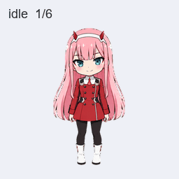

# codex-pet · 02 / Zero Two

《DARLING in the FRANXX》角色 02 的非官方 Q 版动画宠物素材，使用内置 ImageGen 制作，适用于支持 Pets 插件的 ChatGPT Work 环境。

包含 **9 组动作、16 个视线方向、73 个有效帧**，以及生成提示词、源图、检查记录和可独立运行的预览脚本。



[下载最终精灵图](Pets/zero-two/final/spritesheet-extended.png) · [下载整个仓库](https://github.com/lightningwith/codex-pet/archive/refs/heads/main.zip) · [素材索引](Pets/zero-two/ARTIFACTS.md)

## 在 Pets 中使用

1. 下载 `Pets/zero-two/final/spritesheet-extended.png`，保留原始 PNG 尺寸和透明背景。
2. 在支持 Pets 的 ChatGPT Work 环境中启用 Pets 插件，将该 PNG 添加到对话。
3. 可以发送以下请求：

   > 使用 Pets 插件，将这张现成的 v2 精灵图创建成名为「02」的宠物。请先验证精灵图，再上传创建；保留原图，不重新绘制。创建后选择它作为当前宠物。

仓库中的 `pet.json` 提供名称、描述和布局信息。导入会在各自账户中创建宠物；仓库不包含任何账户内的宠物 ID。具体导入能力取决于当前环境是否提供 Pets 的上传与创建工具。

## 常见问题

**宠物只切换静态姿势，悬停时只蹲下怎么办？**

开启 Windows 的“动画效果”，然后完全退出并重新打开 Codex。减少动态效果开启时，宠物可能只显示每组动作的第一帧；跳跃的第一帧正好是蹲下蓄力。

## 精灵图布局

最终文件是 **1536 × 2288 RGBA PNG**，8 列、11 行，每格 192 × 208。未使用的单元格保持透明。行号从 0 开始。

| 行 | 状态 | 有效帧数 |
| --- | --- | --- |
| 0 | `idle` · 待机 | 6 |
| 1 | `running-right` · 向右跑 | 8 |
| 2 | `running-left` · 向左跑 | 8 |
| 3 | `waving` · 挥手 | 4 |
| 4 | `jumping` · 跳跃 | 5 |
| 5 | `failed` · 受挫 | 8 |
| 6 | `waiting` · 等待输入 | 6 |
| 7 | `running` · 工作中 | 6 |
| 8 | `review` · 检查结果 | 6 |
| 9 | 视线 0° 至 157.5° | 8 |
| 10 | 视线 180° 至 337.5° | 8 |

视线方向以画面向上为 0°，顺时针每 22.5° 一格；90° 向右、180° 向下、270° 向左。


## 本地生成预览

需要 Python 3.10 或更新版本。普通 GIF 预览只需要 Pillow：

```sh
python -m pip install -r requirements.txt
python scripts/render_previews.py
```

输出写入 `output/zero-two/`，包含每组动作 GIF、全状态 GIF、视线 GIF、待机与跳跃衔接 GIF 和接触表。脚本直接裁切最终精灵图，不会调用图像生成服务。

生成 MP4 时安装额外依赖并加上 `--mp4`：

```sh
python -m pip install -r requirements-video.txt
python scripts/render_previews.py --mp4
```

可通过 `--atlas PATH` 和 `--output PATH` 指定输入及输出。仓库里的预览是制作时的归档，重新渲染的文件编码可能不同。

## 目录

```text
Pets/zero-two/
  final/             最终精灵图及结构检查
  previews/final/    动作、视线、衔接和视频预览
  prompts/           图像生成提示词
  decoded/           源图与修订素材
  frames/            提取出的动作帧
  references/        基础形象与生成布局参考
  qa/                检查记录和视觉复核
  pet.json           可共享的宠物元数据
  pet_request.json   制作规格
scripts/
  render_previews.py 独立预览脚本
```

检查记录保留了制作过程中的观察和修订，包括中间版本的警告。最终结构检查、质量检查及多数评审的方向盲测结果见 `final/validation-extended.json`、`qa/pet-quality.json`、`qa/blind-validation.json`。部分接近正方向的视线变化较细微，详见 `qa/direction-semantics.json`。

最终精灵图 SHA-256：

```text
7e40bd9cfc62aa9ebb8035ff57a873f6f1b0599e24320f16d68b640865baa1b2
```

`SHA256SUMS` 记录公开文件的校验值。本仓库不收录本地运行依赖、临时生成任务记录和账号相关信息；报告中的本机路径已改为相对路径。原始检查工具随 Pets 插件提供，没有复制到本仓库。

## 许可与角色来源

原创脚本使用 [MIT 许可证](LICENSE)。文档与项目作者有权授权的美术贡献使用 [CC BY 4.0](LICENSE-ASSETS.md)。AI 生成素材是否享有版权可能因适用规则而异；许可仅覆盖作者实际拥有的权利。

02 / Zero Two、DARLING in the FRANXX 的既有角色设计、名称和其他第三方权利不属于本项目的授权范围。本项目为非官方角色衍生创作，与原作及相关权利方无关联，许可证不授予原作角色权利。

参考资料：[动画官方网站](https://www.l-darli-fra.jp/) · [Good Smile 官方角色商品](https://www.goodsmile.com/ja/product/36328/ゼロツー)。
